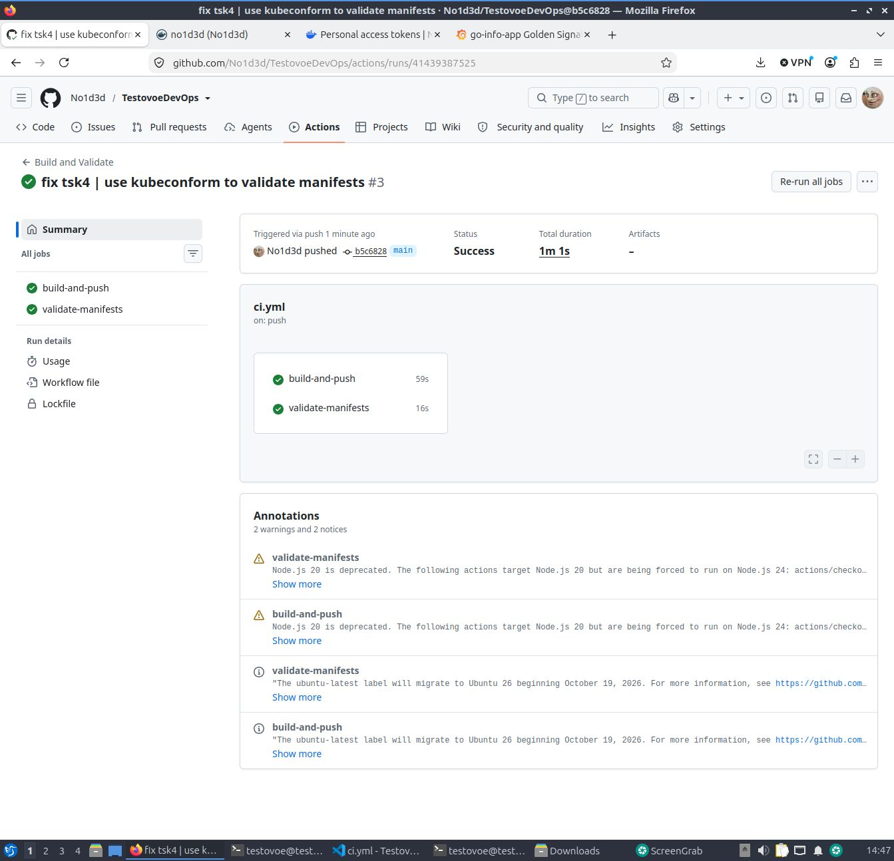
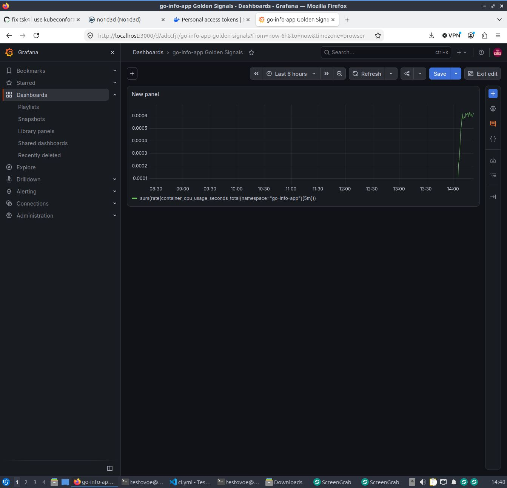

# 04-cicd-observability - CI/CD и Observability

## CI/CD (GitHub Actions)

Конвейер запускается при `push` и `pull_request` в ветку `main`.
Workflow состоит из двух джоб:
1. **build-and-push**: собирает Docker-образ из `01-application` и пушит в Docker Hub с тегами `latest` и `${{ github.sha }}`.
2. **validate-manifests**: проверяет манифесты из `03-kubernetes` через `kubectl apply --dry-run=client`.

### Необходимые секреты (Repository secrets)
В настройках репозитория (Settings - Secrets and variables - Actions) должны быть добавлены:
- `DOCKERHUB_USERNAME` - логин Docker Hub (`no1d3d`).
- `DOCKERHUB_TOKEN` - Personal Access Token с правами Read & Write.



### Локальная проверка манифестов
```bash
kubectl apply --dry-run=client -f 03-kubernetes/
```

### Observability

В кластер (namespace monitoring) установлен kube-prometheus-stack через Helm:
```bash

helm repo add prometheus-community https://prometheus-community.github.io/helm-charts
helm repo update
kubectl create namespace monitoring
helm install kube-prom prometheus-community/kube-prometheus-stack -n monitoring
```

### Сбор метрик приложения

В приложение (01-application/main.go) добавлен эндпоинт /metrics.

Создан ServiceMonitor (servicemonitor.yaml), который указывает Prometheus собирать метрики с приложения каждые 15 секунд.

Созданы правила алертинга (prometheusrule.yaml) на недоступность приложения (AppTargetDown) и сбои readiness-проб (AppReadinessFailing).

### Дашборд Grafana

Дашборд «Golden Signals» (dashboard.json) содержит 4 панели:



Traffic: sum(rate(http_requests_total{job="go-info-app"}[5m]))

Errors: sum(rate(http_requests_total{job="go-info-app", status=~"5.."}[5m]))

Latency (p95): histogram_quantile(0.95, sum(rate(http_request_duration_seconds_bucket{job="go-info-app"}[5m])) by (le))

Saturation (CPU): sum(rate(container_cpu_usage_seconds_total{namespace="go-info-app"}[5m]))

### Доступ к Grafana
```bash
kubectl port-forward -n monitoring service/kube-prom-grafana 3000:80
```
Открыть http://localhost:3000. Логин: admin. Пароль получается командой:
```bash
kubectl get secret -n monitoring kube-prom-grafana -o jsonpath="{.data.admin-password}" | base64 --decode
```
В моем случае - 6UejijME0uE6ZJaGry2H8n0gdQ76e9irOFzXsOfo
